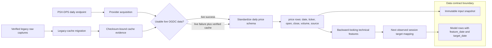
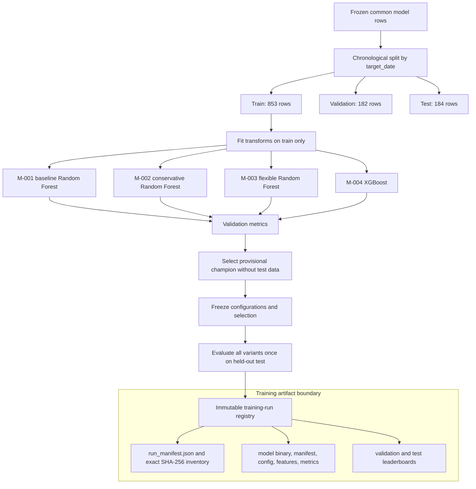
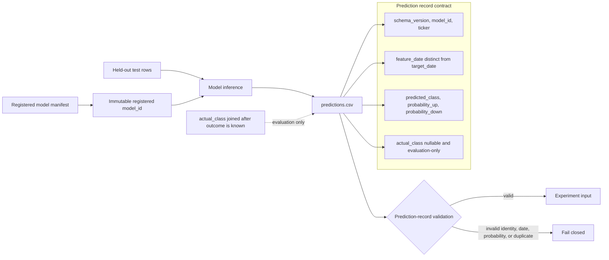
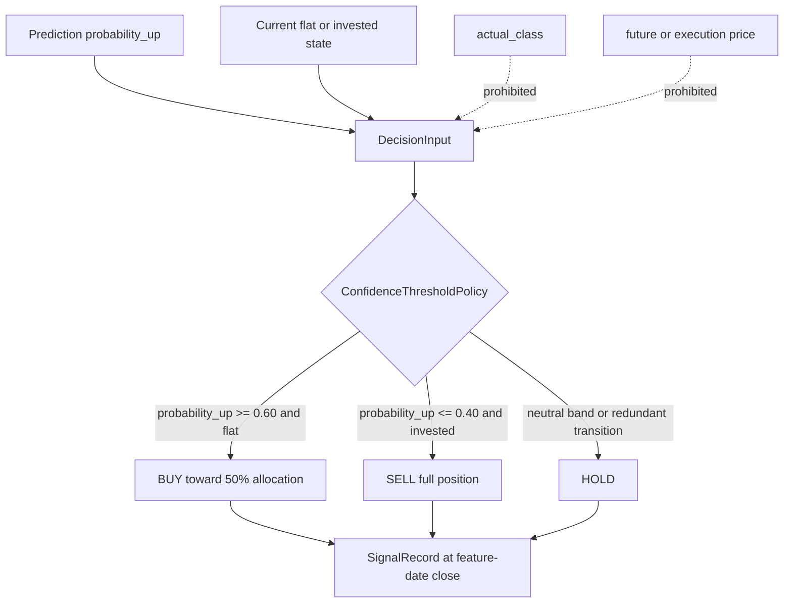
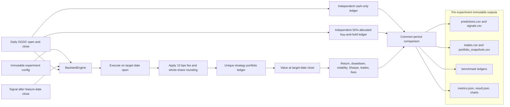
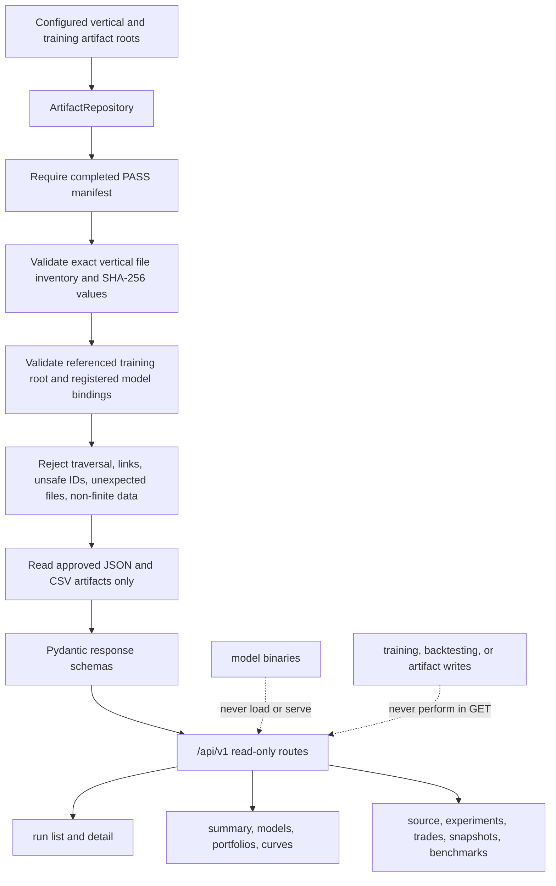
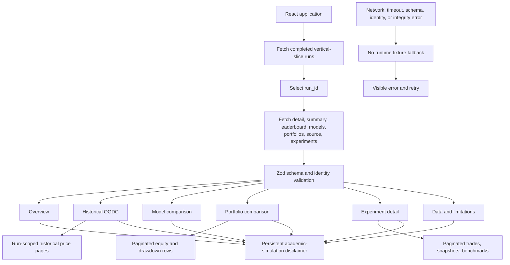
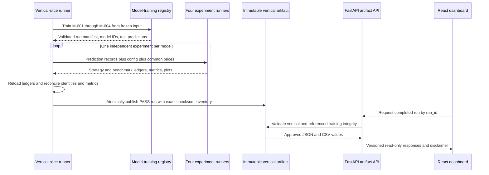

# PAISA architecture overview

This document describes the implemented OGDC daily-data vertical slice. The
components are intentionally separated: data preparation owns market and feature
records; a model owns predictions; a policy owns signals; a portfolio owns cash,
holdings, trades, and valuation; the API validates and delivers immutable
artifacts; and the dashboard only presents API responses.

All predictions, signals, trades, portfolio curves, and returns are academic
simulations and are not financial advice.

## Component contracts

| Component | Consumes | Produces | Does not own |
|---|---|---|---|
| Data and feature pipeline | Provider rows and acquisition evidence | Standard daily prices, backward-looking features, next-session labels, provenance | Model choice, signals, balances |
| Model training | Frozen model rows and chronological split contract | Immutable model bundle, metrics, test prediction records | Trading policy or portfolio state |
| Prediction artifact | Registered model identity and evaluation rows | One record per model/ticker/feature date/target date | Trade decisions or cash |
| Decision policy | `probability_up`, thresholds, current position | BUY, HOLD, or SELL signal and target allocation | Actual label, estimator fitting, execution price |
| Portfolio/backtest | Signals, daily open/close bars, immutable experiment config | Trades, snapshots, metrics, independent benchmark ledgers | Feature calculation or inference |
| FastAPI artifact API | Completed run and referenced training trees | Schema-validated, read-only JSON | Retraining, backtesting, binary serving, writes |
| React dashboard | Versioned API responses | Tables, charts, warnings, provenance, disclaimer | Financial calculations or fallback data |

The normative schema details remain in
[`ARCHITECTURE_CONTRACTS.md`](ARCHITECTURE_CONTRACTS.md). The diagrams below show
how the implemented code realizes those boundaries.

## 1. Data pipeline



Implemented entry points:

- `scripts/run_v0_pipeline.py` and `src/paisa/pipeline.py` orchestrate providers,
  standardization, feature creation, labels, and legacy v0 outputs.
- `src/paisa/preprocessing.py` standardizes source frames.
- `src/paisa/features.py` builds technical features and the v0 ML dataset.
- `scripts/migrate_legacy_psx_cache.py` and `src/paisa/legacy_cache.py` create and
  verify the legacy-cache evidence bundle.
- `src/paisa/vertical_slice.py` freezes the exact selected price and provenance
  bytes before model training.

For `VSL-20261020-OGDC-main-02`, the live request failed and the selected input
was a verified legacy PSX-DPS reconstruction: 1,239 OGDC daily rows covering
2021-09-16 through 2026-09-15. It is not represented as a successful fresh
fetch.

## 2. Model training



The versioned CPU training entry point is `scripts/train_ogdc_models.py`, backed by
`src/paisa/experiments/trainer.py`. Feature, split, target, and evaluation rules
live in `training_features.py`, `training_targets.py`, and `evaluation.py`.
`M-001` is the validation-selected model for the completed run. Test metrics are
reporting evidence, not a model-selection input.

## 3. Prediction artifacts



The test `predictions.csv` for each registered model is stored below
`artifacts/model_training/<training_run_id>/models/<registered_model_id>/`.
The vertical slice derives those paths and model bindings from the validated
training root; caller-provided paths cannot redirect the run. Probabilities must
be finite, sum to one within tolerance, and retain the estimator's declared class
mapping.

## 4. Decision policy



`src/paisa/trading/policy.py` implements the inclusive confidence thresholds and
long-only target-allocation state transition. `DecisionInput` intentionally has
no actual label or market-price field. Repeated buys do not pyramid an existing
position; a sell while already in cash becomes HOLD.

## 5. Portfolio and backtesting engine



`src/paisa/backtesting/engine.py` validates chronological prediction/session
alignment and orchestrates one strategy. `src/paisa/trading/execution.py` and
`portfolio.py` own fills and accounting. `src/paisa/backtesting/benchmarks.py`
creates separately funded cash-only and buy-and-hold ledgers.
`src/paisa/experiments/runner.py` persists one atomic experiment. No portfolio
ID, cash balance, holding, trade, or snapshot is shared between experiments.

The classification target measures feature-close to next-session-close
direction; the simulation enters at the next-session open. That deliberate
difference is carried as a warning because accuracy and profitability measure
different things.

## 6. FastAPI artifact API



The application is `src/paisa/api/main.py`. The additive v1 router is
`src/paisa/api/router_v1.py`; secure artifact access is implemented in
`src/paisa/api/artifact_repository.py`; response contracts are in
`src/paisa/api/schemas.py`.

The service exposes, among others:

```text
GET /api/v1/vertical-slices
GET /api/v1/vertical-slices/{run_id}
GET /api/v1/vertical-slices/{run_id}/summary
GET /api/v1/vertical-slices/{run_id}/stocks/{ticker}/prices
GET /api/v1/vertical-slices/{run_id}/models
GET /api/v1/vertical-slices/{run_id}/portfolios
GET /api/v1/vertical-slices/{run_id}/equity-curves
GET /api/v1/vertical-slices/{run_id}/drawdowns
GET /api/v1/vertical-slices/{run_id}/source
GET /api/v1/vertical-slices/{run_id}/experiments
GET /api/v1/vertical-slices/{run_id}/experiments/{experiment_id}/trades
GET /api/v1/vertical-slices/{run_id}/experiments/{experiment_id}/snapshots
GET /api/v1/vertical-slices/{run_id}/experiments/{experiment_id}/benchmarks
```

Legacy v0 routes remain compatible, but the dashboard uses the selected run's
v1 price endpoint rather than `data/processed/psx_prices.csv`.

## 7. React dashboard



`frontend/src/App.tsx` coordinates run selection and views.
`frontend/src/api/client.ts` owns HTTP access, timeouts, pagination, cancellation,
Zod validation, identity checks, and local-path rejection. Components below
`frontend/src/components/` render the six read-only views. The browser never
loads artifacts or model binaries and does not recompute model or portfolio
metrics.

## End-to-end publication and read path



The completed demonstration run is stored locally at
`artifacts/vertical_slice/VSL-20261020-OGDC-main-02/` and references
`artifacts/model_training/TRN-20261020-191815-624662-nogit/`. These directories
contain runtime data and model artifacts, are ignored by Git, and must not be
committed.
